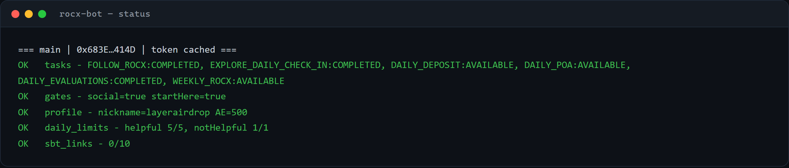

# RocX Testnet Bot (LYID)

Automation for the **RocX testnet** (Base Sepolia) — earns Active Energy (AE) by running the daily
mission set through the official API. No browser, no wallet extension, no seed-phrase signing UI:
the bot signs SIWE challenges and EIP-712 payloads locally with your own key.



> RocX is a testnet. AE is a non-transferable participation unit, not money. Point values and
> mission rules can change at any time — the bot always re-reads the mission catalog before acting.

---

## Features

| Feature | Command | Notes |
|---|---|---|
| SIWE login (24h token cache) | `login` / automatic | `POST /auth/challenge` → personal_sign → `POST /auth/login` |
| Daily check-in (+100 AE) | `daily` | `attendance/challenge` → sign → `attendance/complete` |
| Start-here social mission (+300 AE, once) | `daily` | Verifies the X account already linked to the wallet, then claims |
| Evaluate 5 + 1 activities (+100 AE/day) | `daily` | Opens the original first (server requires it), signs each vote |
| PoA link registration (+300 AE/day) | `register --url` | The post must be authored by the X account linked to the wallet |
| Weekly X post (+500 AE/week) | `weekly` | Bot gives you the week's code; submit the post id afterwards |
| USDC deposit mission (+100 AE/day) | `daily --deposit` | Claims free test USDC, deposits into the RocX PoA vault on Base Sepolia |
| Status / balances | `status`, `accounts` | Tasks, gates, AE, evaluation quota, on-chain balances |
| Humanizer | always on | per-wallet UA/locale, gaussian delays 1.4–4.2 s, randomized task order, 8% skip chance |

AE sources observed on a fresh wallet: 300 (follow) + 100 (check-in) + 300 (PoA link) + 100
(evaluations) + 100 (deposit) + 500 (weekly) ≈ **1,400 AE per week** per wallet before the game/AE
sinks and the Top-1,000 OG SBT campaign (needs 10 distinct registered links).

---

## Requirements

| Requirement | Detail |
|---|---|
| Node.js | 20 or newer (`node -v`) |
| Package | `ethers` v6 (installed by `npm install`) |
| Wallet | Any EVM private key. One X account must be linked to it once, manually, on the site |
| Gas | Base Sepolia ETH only for `--deposit` (~0.0002 ETH per run). Free from `https://www.alchemy.com/faucets/base-sepolia` |
| Test USDC | Free, bot claims it itself (`claim()` on the RocX test-USDC token) |
| X account | Needed for: follow mission (verified server-side), PoA registration, weekly post |

---

## Setup

```bash
cd rocx-bot
npm install
copy config.json.example config.json   # Windows
```

Edit `config.json`:

```json
{
  "accounts": [
    {
      "label": "main",
      "privateKey": "0x....",
      "xHandle": "yourhandle",
      "poaUrl": "",
      "weeklyPostId": ""
    }
  ]
}
```

One-time manual step per wallet (30 seconds, cannot be automated):

1. Open <https://rocx-testnet.com/app/explore/missions> and connect the wallet.
2. Go to `My Page → Social` and connect the X account (OAuth).
3. Done — the bot takes over from here.

Windows users can double-click `JALANKAN.bat` for an Indonesian menu instead of typing commands.

---

## Usage

```bash
node index.js accounts                      # wallets + ETH / PoA-USDC / Aave-USDC balances
node index.js status                        # tasks, gates, AE balance, evaluation quota, SBT links
node index.js daily                         # check-in + evaluations + follow claim
node index.js daily --deposit               # + claim USDC and deposit into the PoA vault
node index.js register --url https://x.com/you/status/1234567890
node index.js weekly --challenge            # prints this week's post code
node index.js weekly --post-id 1234567890   # after you publish the post
node index.js deposit                       # deposit only
node index.js login --relogin               # force a fresh SIWE session
```

Daily cron (WIB) — the project day resets at **07:00 WIB** (00:00 UTC):

```
10 7 * * *  cd C:\Users\<you>\LYID-BOTS\rocx-bot && node index.js daily --deposit
```

Every run writes `data/last-run.json` (machine) and `data/last-run.txt` (console lines) so you can
verify what actually happened, including tx hashes.

---

## How it works

| Action | Endpoint |
|---|---|
| Login | `POST /api/v1/auth/challenge` → `POST /api/v1/auth/login` (Bearer, ~24h) |
| Mission state | `GET /api/v1/tasks` (`status`, `blockedReason`, `rewardAe`) |
| Check-in | `POST /api/v1/attendance/challenge` → `POST /api/v1/attendance/complete` |
| Mission claim | `POST /api/v1/tasks/testnet/{id}/verify` → `.../claim` |
| PoA feed | `GET /api/v1/poa/archive/rounds/poa-continuous/activities?limit=50&offset=0` |
| Open original (required before voting) | `POST /api/v1/poa/discovery/activities/{id}/open` |
| Vote / register | `POST /api/v1/poa/actions/prepare` → EIP-712 sign → `POST /api/v1/poa/actions/submit` |
| Daily quota | `GET /api/v1/poa/discovery/me/daily` (5 helpful + 1 not helpful) |
| Weekly | `POST /api/v1/missions/x-weekly/challenge` → `POST /api/v1/missions/x-weekly/submit` |
| Deposit | USDC `claim()` → `approve` → `depositToken(token, amount)` on the RocX vault (Base Sepolia) |
| SBT campaign | `GET /api/v1/explore/top1000/me` |

Contracts (Base Sepolia, chain id 84532):

- Aave V3 pool: `0x8bab6d1b75f19e9ed9fce8b9bd338844ff79ae27`
- Aave test USDC: `0xba50cd2a20f6da35d788639e581bca8d0b5d4d5f`
- RocX PoA vault: `0x7537256b27ed74fe6166ca64cc33145eb82709d5`
- PoA test USDC (has `claim()`): `0x0f9f05391818bffbe9bacdbfaed6c05928a41cbb`

---

## Humanization

- Deterministic per-wallet persona (Chrome version, `Accept-Language`) derived from the address.
- Gaussian jitter 1.4–4.2 s between every action, plus extra pauses before signatures.
- Daily blocks (check-in / evaluations / deposit) run in a random order each day.
- 8% chance to skip an optional block per run; votes pick random feed pages and random activities
  rather than the newest six.
- No parallel requests: one wallet at a time, like a person using the site.

This blends request timing, not network origin. All wallets share your IP; if a project later adds
IP-based rules, run accounts from separate connections.

---

## Troubleshooting

| Symptom | Fix |
|---|---|
| `login failed: 401` | Session expired mid-run — run `node index.js login --relogin` |
| `Complete Start here first` | The X account is not linked, or does not follow @RocX_official. Link it on My Page → Social |
| `403 ORIGINAL_CONTENT_NOT_OPENED` | The bot always opens the original first; if it repeats, the activity was removed — rerun |
| `SOCIAL_AUTHOR_MISMATCH` | `--url` points at a post that is not from the X account linked to this wallet |
| `MISSION_DEPOSIT_NOT_FOUND` | RocX credits deposits after its own finalization pass. Re-run `node index.js deposit` later; the bot polls automatically for ~5 minutes |
| `Mint timelock exceeded` | The Aave-USDC faucet allows 1 USDC per window; the vault USDC faucet (`claim()`) is used instead |
| `insufficient funds for gas` | Send Base Sepolia ETH to the wallet (free Alchemy faucet) |
| `npm ERR!` on install | Use Node 20+; delete `node_modules` and `package-lock.json`, then `npm install` |

---

## Security

- `config.json`, `data/`, `sessions.json` are git-ignored. Never commit them.
- The bot never asks for a seed phrase — only the private key of a dedicated farming wallet.
- Do not use a wallet that holds real assets. Base Sepolia is a testnet; the key is still a key.
